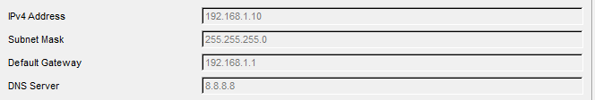
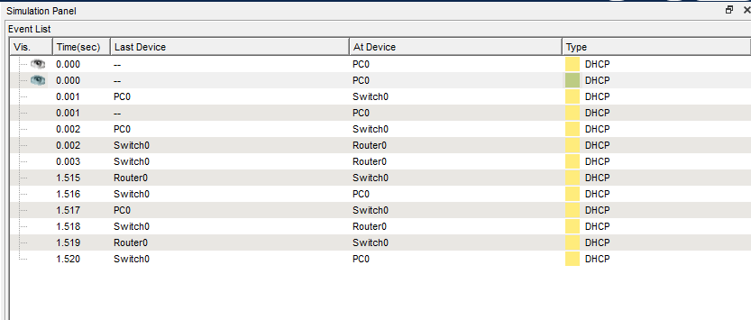

# Chapter 8 — Networking basics, verified on the VM

Goal: understand how a packet is built, and prove each idea on my own VM instead of only reading about it. 8.1 learned on **Day 15** (2026-11-17); 8.2 (IP and subnets) follows on Day 16.

## 8.1 Layers and packet capture

### The TCP/IP model (4 layers)

Every packet is wrapped layer by layer, like a parcel: each layer adds its own **header** around what the layer above gave it (**encapsulation**). The receiver unwraps from the outside in.

```text
[ Ethernet header [ IP header [ TCP/ICMP header [ data ] ] ] ]
```

| Layer | Job | Parcel analogy | Seen on my VM |
|---|---|---|---|
| 4 Application | what the data **is** | the goods in the box | HTTP (`curl localhost`), SSH, the `ls` I type over SSH |
| 3 Transport | which **program** on the machine | recipient's name | TCP, **ports**: 22 = sshd, 80 = nginx |
| 2 Network (Internet) | which **machine**, end to end | delivery address | **IP**: `192.168.207.130`, ICMP, TTL |
| 1 Link | which device **next**, inside this LAN | the courier's hand-off slip | **MAC**, ARP, NIC `ens33` |

Rule of thumb: content → application; port → transport; IP → network; MAC / NIC → link.

### The OSI model (7 layers)

The textbook model splits the same stack more finely. Interviews ask about it.

| OSI | Name | TCP/IP | Examples |
|---|---|---|---|
| **7** | Application | Application | HTTP, SSH, DNS |
| 6 | Presentation | Application | encryption, encoding |
| 5 | Session | Application | keeping a connection open |
| **4** | Transport | Transport | TCP, UDP, ports |
| **3** | Network | Network | IP, ICMP, routers |
| **2** | Data Link | Link | MAC, ARP, Ethernet, switches |
| 1 | Physical | Link | cable, fibre, Wi-Fi signal |

Bottom-up mnemonic: **P**lease **D**o **N**ot **T**hrow **S**ausage **P**izza **A**way.

"Layer 2 problem" = MAC / switch / ARP; "Layer 3 problem" = IP / routing; "L4 load balancer" = by IP + port; "L7 load balancer" = by HTTP content.

### Capture a ping with tcpdump

`tcpdump` prints every packet that passes a network interface. Two SSH windows: A captures, B pings.

```console
# window A
admin123@admin:~$ sudo tcpdump -i ens33 -n icmp
listening on ens33, link-type EN10MB (Ethernet), snapshot length 262144 bytes
09:16:42.979892 IP 192.168.207.130 > 8.8.8.8: ICMP echo request, id 19790, seq 1, length 64
09:16:42.986651 IP 8.8.8.8 > 192.168.207.130: ICMP echo reply, id 19790, seq 1, length 64
...
^C
8 packets captured

# window B
admin123@admin:~$ ping -c 4 8.8.8.8
```

| Part | Meaning |
|---|---|
| `-i ens33` | only this interface |
| `-n` | show IPs as numbers, no name lookups |
| `icmp` | filter: only ping packets (otherwise my own SSH traffic floods the screen) |
| `-c 8` | stop after 8 packets (`ping -c 4` = send 4: 4 requests + 4 replies = 8) |
| `-w file.pcap` | write packets to a file instead of printing |

Reading a line: time · `IP` · source `>` destination · `ICMP echo request` (ping) / `echo reply` (answer) · `seq` number. Request → reply took about 7 ms, the same as `ping` reports. **No port numbers**: ICMP sits directly in IP (layer 3) and never uses TCP.

Save to a file and copy it to Windows:

```console
admin123@admin:~$ sudo tcpdump -i ens33 -n icmp -c 8 -w ~/ping.pcap
8 packets captured
admin123@admin:~$ ls -l ~/ping.pcap
-rw-r--r-- 1 tcpdump tcpdump 936 Nov 17 09:20 /home/admin123/ping.pcap
```

The file is owned by `tcpdump`: after starting with `sudo`, tcpdump drops to its own unprivileged user before writing (least privilege). Others still have `r`, so I can copy it.

```powershell
# Windows PowerShell — NOT inside the VM
PS C:\Users\HP> scp admin123@192.168.207.130:~/ping.pcap $HOME\Desktop\
ping.pcap                                  100%  936   457.1KB/s   00:00
```

`scp source destination`, like `cp`. The side with `user@host:` is the remote machine (path after `:` is on that machine); the side without it is the local machine. Upload = swap the two sides.

### Read the layers in Wireshark

Opened `ping.pcap` in Wireshark (Windows). Top pane = packet list, middle = layers of the selected packet, bottom = raw bytes.


Packet 1 (echo request):

| Wireshark line | Layer | Key fields |
|---|---|---|
| Frame 1 | — (capture info, not a real header) | 98 bytes |
| Ethernet II | 2 Data Link | Src `00:0c:29:fb:c4:c2` (my VM), **Dst `00:50:56:e2:d7:15`** |
| Internet Protocol Version 4 | 3 Network | Src `192.168.207.130`, Dst `8.8.8.8`, **TTL 64**, Protocol ICMP (1) |
| Internet Control Message Protocol | 3 Network (ICMP rides inside IP) | Type 8 = echo request, seq 1 |

No TCP/UDP line: ping does not use the transport layer.

### Finding 1: the destination MAC is not Google's

The packet goes to `8.8.8.8`, but the destination MAC belongs to a VMware device. Checked on the VM:

```console
admin123@admin:~$ ip route
default via 192.168.207.2 dev ens33 proto dhcp src 192.168.207.130 metric 100
192.168.207.0/24 dev ens33 proto kernel scope link src 192.168.207.130 metric 100
admin123@admin:~$ ip neigh
192.168.207.1 dev ens33 lladdr 00:50:56:c0:00:08 REACHABLE
192.168.207.254 dev ens33 lladdr 00:50:56:fe:3c:5b STALE
192.168.207.2 dev ens33 lladdr 00:50:56:e2:d7:15 STALE
```

The default gateway is `192.168.207.2`, and its MAC is exactly the destination MAC in the capture.

- **IP = final destination**, unchanged end to end.
- **MAC = next hop** on the local network, rewritten at every router.

The VM learns a neighbour's MAC with **ARP** (broadcast "who has 192.168.207.2?"); answers are cached in `ip neigh`. All three neighbours start with `00:50:56`, VMware's vendor prefix.

| Address | Device (VMware NAT defaults) |
|---|---|
| .1 | Windows host, VMnet8 adapter (my SSH client → `REACHABLE`) |
| .2 | NAT gateway |
| .128–.253 | DHCP pool; my VM got .130 (was .129 before a reboot) |
| .254 | VMware DHCP server |

### Finding 2: TTL 64 out, 128 back

TTL (Time to Live) = how many routers a packet may still cross; each router subtracts 1, at 0 it is dropped (stops routing loops). Default start: **Linux 64, Windows 128**.

- Request: TTL **64** → just left my Linux VM, no router passed yet (captured on the VM's own NIC).
- Reply: TTL **128**, exactly Windows' start value with nothing subtracted. Most likely the VMware NAT service on the Windows host built this reply itself instead of forwarding Google's original packet (which would arrive as a start value minus a dozen or so hops).

TTL hints at the sender's OS and how many hops away it is.

### Mistakes I made (Day 15)

| Typed | Problem | Fix |
|---|---|---|
| `scp ...` inside the VM | prompt was `admin123@admin:~$`; scp must run on Windows | check the prompt: `PS C:\...>` = Windows |
| `ping.pacp` | typo | `.pcap` = packet capture |
| `$HOME\Desktop\` in bash | trailing `\` = "command continues on the next line" | Windows paths only in PowerShell |
| ICMP = layer 7 | ICMP is part of layer 3 | no port → not layer 4+ |
| the `ls` I type over SSH = link layer | it is the data itself | application layer |

## 8.2 IP addresses and subnets

Learned on **Day 16** (2026-11-17, evening).

### An IPv4 address

`192.168.207.130` = 4 numbers, each **0–255** because each is 8 bits (`11111111` = 255) → 32 bits in total.

An address has two parts, like a street and a house number:

```text
192.168.207 . 130          (with /24)
network part  host part
```

Two addresses can talk directly (via MAC/ARP, no router) only if their **network parts match**. With `/24`: `192.168.207.9` is on my VM's network; `192.168.208.130` is not.

### Prefix (CIDR) and subnet mask

`/24` = the first 24 bits are the network part. The subnet mask writes the same thing with 1s for the network bits:

```text
/24 = 11111111.11111111.11111111.00000000 = 255.255.255.0
```

`/24` (CIDR) and `255.255.255.0` (mask) mean exactly the same.

### How many addresses

```text
host bits     = 32 − prefix
total         = 2^(host bits)          ← the "block size"
usable hosts  = total − 2
```

The first address (host bits all 0) is the **network address**; the last (host bits all 1) is the **broadcast address** (sent to every device on the network, e.g. an ARP "who has …?"). Neither can be given to a device.

| Prefix | Host bits | Block size | Usable | Mask (last byte) |
|---|---|---|---|---|
| /24 | 8 | 256 | 254 | .0 |
| /25 | 7 | 128 | 126 | .128 |
| /26 | 6 | 64 | 62 | .192 |
| /27 | 5 | 32 | 30 | .224 |
| /28 | 4 | 16 | 14 | .240 |
| /29 | 3 | 8 | 6 | .248 |
| /30 | 2 | 4 | 2 | .252 |

Each +1 on the prefix halves the block.

### Block-size method (no binary needed)

Example `192.168.1.100/26`:

1. **Write the prefix and block size first:** /26 → 2⁶ = **64**.
2. Cut the last number into blocks from 0: `0–63 | 64–127 | 128–191 | 192–255`.
3. 100 falls in **64–127**.
4. First of the block = network **.64**; last = broadcast **.127** (= network + block − 1); usable **.65–.126**, **62** hosts.

### My VM

```console
admin123@admin:~$ ip addr show ens33
    inet 192.168.207.130/24 ... brd 192.168.207.255 ...
admin123@admin:~$ ip route
192.168.207.0/24 dev ens33 proto kernel scope link src 192.168.207.130 metric 100
```

| | Value |
|---|---|
| Prefix / block | /24 → 256 (the whole last byte is one block) |
| Network address | 192.168.207.0 (the `ip route` line) |
| Broadcast | 192.168.207.255 (`brd` in `ip addr`) |
| Usable | .1–.254, 254 hosts |
| In use | .1 Windows host · .2 NAT gateway · .128–.253 DHCP pool (my VM: .130) · .254 DHCP server |

This is also why `ssh` to `192.168.207.255` on Day 1 could not work: it is the broadcast address, not a machine.

### 10 practice questions (closed book, 10/10)

| # | Address | Network | Broadcast | Usable range | Hosts |
|---|---|---|---|---|---|
| 1 | 192.168.1.10/24 | .0 | .255 | .1–.254 | 254 |
| 2 | 192.168.1.130/25 | .128 | .255 | .129–.254 | 126 |
| 3 | 172.16.5.70/26 | .64 | .127 | .65–.126 | 62 |
| 4 | 10.1.1.45/27 | .32 | .63 | .33–.62 | 30 |
| 5 | 192.168.10.200/28 | .192 | .207 | .193–.206 | 14 |
| 6 | 192.168.0.13/29 | .8 | .15 | .9–.14 | 6 |
| 7 | 10.0.0.6/30 | .4 | .7 | .5–.6 | 2 |
| 8 | 172.16.0.250/26 | .192 | .255 | .193–.254 | 62 |

9. A department needs **50** hosts → **/26** (62 usable); /27 gives only 30.
10. With /27: `.33` and `.62` are on the same network (both in .32–.63); `.33` and `.64` are not (.64 starts the next block).

### Mistakes I made (Day 16, while learning)

| Wrote | Problem | Fix |
|---|---|---|
| /25 → 224 addresses | 2⁷ is 128 | count: 2, 4, 8, 16, 32, 64, 128, 256 |
| `192.168.1.200/27` → broadcast .255, range .193–.254 | cut the blocks by 64 instead of 32 | blocks of 32: .192–.223 → broadcast .223 |
| `10.0.0.77/28` → range .63–.78 | range starts **after** the network address | .65–.78 |
| my VM `/24` worked out as /26 (.128 / .191) | read the prefix wrong | always write prefix + block size first |
| warm-up: `unique -c` | no such command | `uniq -c` |
| warm-up: `du -sh /var/*` without sorting | biggest directory hard to spot | `sudo du -sh /var/* 2>/dev/null \| sort -h` |

## 8.3 Routing and NAT

Learned on Day 17. One question decides where every packet goes: **is the destination on my network?**

- **Yes** → send it straight to that machine (ARP finds its MAC, see 8.4).
- **No** → hand it to the **default gateway** (a router), which forwards it on.

### The routing table on the VM

```console
admin123@admin:~$ ip route
default via 192.168.207.2 dev ens33 proto dhcp src 192.168.207.130 metric 100
192.168.207.0/24 dev ens33 proto kernel scope link src 192.168.207.130 metric 100
192.168.207.2 dev ens33 proto dhcp scope link src 192.168.207.130 metric 100
```

| Line | Meaning |
|---|---|
| `default via 192.168.207.2` | everything not matched below → gateway `.2` (VMware NAT) |
| `192.168.207.0/24 dev ens33` | my own network: no `via`, sent directly |
| `192.168.207.2 dev ens33` | added by DHCP: the gateway itself is directly reachable |
| `metric 100` | priority when two routes match; **lower wins** |

Ask the system which route it actually picks:

```console
admin123@admin:~$ ip route get 8.8.8.8
8.8.8.8 via 192.168.207.2 dev ens33 src 192.168.207.130 uid 1000      ← via = through the gateway
admin123@admin:~$ ip route get 192.168.207.1
192.168.207.1 dev ens33 src 192.168.207.130 uid 1000                  ← no via = direct
```

### traceroute: every hop on the way

Each router lowers TTL by 1; the router where it hits 0 sends back "time exceeded". traceroute sends TTL 1, 2, 3 … and lists who answered.

```console
admin123@admin:~$ sudo apt install -y traceroute
admin123@admin:~$ sudo traceroute -n -I 8.8.8.8
 1  192.168.207.2  0.922 ms  0.860 ms  0.819 ms
 2  * * *
 ...
 8  * * *
 9  8.8.8.8  8.532 ms  8.451 ms  8.373 ms
```

- `-n` numbers only (no DNS lookups), `-I` use ICMP like ping (needs `sudo`; gets more answers through VMware NAT).
- Hop 1 is the default gateway from `ip route`.
- `* * *` = that router did not answer (many ISPs block it). **Not a failure** as long as the destination answers at the end. Only stars from some hop all the way to 30 means the path breaks there.

### NAT: why the internet never sees 192.168.207.130

Private ranges (not routed on the internet): **`10.0.0.0/8`, `172.16.0.0/12`, `192.168.0.0/16`**.
On the way out, a NAT gateway replaces the private source address with its own and swaps it back on the reply.

```console
admin123@admin:~$ curl -s ifconfig.me ; echo      # -s = silent, no progress bar
161.142.151.164                                    # public, not in any private range
```

My VM goes through **two NATs**:

```
VM 192.168.207.130   (VMnet8, gateway .2)
  → VMware NAT 192.168.207.2        NAT 1: source becomes Windows' 192.168.100.4
  → home router 192.168.100.1       NAT 2: source becomes public 161.142.151.164
  → internet → 8.8.8.8
```

On Windows, `ipconfig` (short version: `ipconfig | findstr IPv4`):

| Adapter | IPv4 | Gateway | Note |
|---|---|---|---|
| WLAN | 192.168.100.4 | 192.168.100.1 | the one actually used for internet |
| VMnet8 | 192.168.207.1 | (none) | Windows' own address on the VM network; **not** the gateway (that is `.2`) |
| VMnet1 | 192.168.50.1 | 192.168.50.254 | host-only network, set by hand for course labs; leave it |
| `169.254.x.x` adapters | — | — | asked DHCP, got no answer, picked an address itself → **169.254 = DHCP failed** |

Why VMnet8 has no gateway: a machine should have **one** default exit. VMnet8 only talks to the VMs on its own /24, which needs no gateway. VM traffic leaves through the VMware NAT service, which uses Windows' normal WLAN route.

VMware network types: **VMnet0 Bridged** (VM gets an address from the real router) · **VMnet1 Host-only** (no internet) · **VMnet8 NAT** (internet through `.2`).

### Two default gateways, decided by metric (real example)

```console
PS C:\Users\HP> route print -4 0.0.0.0
活动路由:
网络目标        网络掩码          网关       接口   跃点数
          0.0.0.0          0.0.0.0    192.168.100.1    192.168.100.4    200
          0.0.0.0          0.0.0.0   192.168.50.254     192.168.50.1    291
永久路由:
          0.0.0.0          0.0.0.0   192.168.50.254     默认
```

Both are `0.0.0.0/0` (default). Metric 200 < 291 → WLAN is used; the VMnet1 route is only a fallback. It is listed under **永久路由**, so it was added by hand with `route -p add`. Risk: if Wi-Fi drops, Windows tries VMnet1 and fails. Kept for now (course labs).

### Lab: two networks and one router in Packet Tracer

File: [`labs/day17-routing.pkt`](labs/day17-routing.pkt) (Cisco Packet Tracer 9.0; local copy in `C:\Users\HP\Cisco Packet Tracer 9.0.0\saves\`).


```
PC0 192.168.1.10 ── Switch0 ── G0/0 192.168.1.1 [Router0] G0/1 192.168.2.1 ── Switch1 ── PC1 192.168.2.10
      network A: 192.168.1.0/24                                    network B: 192.168.2.0/24
```

Router (2911, CLI tab; answer `no` to the setup dialog):

```
enable                                  ! Router#        (short: en)
configure terminal                      ! Router(config)# (short: conf t)
no ip domain-lookup                     ! stop typos from being looked up in DNS
interface g0/0                          ! Router(config-if)#
 ip address 192.168.1.1 255.255.255.0   ! Cisco takes a mask, not /24
 no shutdown                            ! interfaces start "administratively down"
interface g0/1
 ip address 192.168.2.1 255.255.255.0
 no shutdown
end
show ip interface brief                 ! short: sh ip int br
```

```
Interface              IP-Address      OK? Method Status                Protocol
GigabitEthernet0/0     192.168.1.1     YES manual up                    up
GigabitEthernet0/1     192.168.2.1     YES manual up                    up
GigabitEthernet0/2     unassigned      YES unset  administratively down down
```

Both columns `up` = cable connected **and** link working. `administratively down` = never given `no shutdown` (red link lights).

PCs (Desktop → IP Configuration → Static): IP, mask `255.255.255.0`, **gateway = the router interface on their side** (`.1`).

| PC | IPv4 | Gateway |
|---|---|---|
| PC0 | 192.168.1.10 | 192.168.1.1 |
| PC1 | 192.168.2.10 | 192.168.2.1 |

Test from PC0:

```
C:\>ping 192.168.2.10
Request timed out.                                    ← first packet lost while ARP resolves the gateway's MAC
Reply from 192.168.2.10: bytes=32 time<1ms TTL=127    ← 128 − 1 router = 127
...
C:\>tracert 192.168.2.10
  1   0 ms   0 ms   0 ms   192.168.1.1                ← PC0's default gateway
  2   2 ms   0 ms   0 ms   192.168.2.10
```

Reading TTL backwards: start values Linux **64**, Windows **128**, Cisco **255**. `TTL=127` → 1 router on the way; `ping 192.168.1.1` replied `TTL=255` → the router itself, 0 hops.

### Broken on purpose: PC0 without a gateway

| Test | Result | Why |
|---|---|---|
| `ping 192.168.1.1` | 4/4 replies | same network → sent directly, no gateway needed |
| `ping 192.168.2.10` | `Request timed out` | other network → needs the gateway, and there is none |

Rule: **same network works, other networks don't → check the gateway first** (`ip route` on Linux, `ipconfig` on Windows, IP Configuration in Packet Tracer).

### Mistakes I made (Day 17)

| Wrote | Problem | Fix |
|---|---|---|
| warm-up: /24 → 255 addresses, 253 usable | 255 is the highest number, not the count (numbering starts at 0) | 2⁸ = **256**, usable **254** |
| `ip address 192.168.2.1 255.255.255.` + Enter | mask missing its last `0` | retype the whole line |
| `end` typed again at `Router#` | unknown word → IOS tries to telnet to a host called "end" and looks it up in DNS (`Translating "end"...`) | `Ctrl+Shift+6` to abort; `no ip domain-lookup` once in config mode |

## 8.4 DHCP and ARP

Learned on Day 18. Two helpers that run before any real traffic:

- **DHCP**: a new machine has no IP; DHCP rents it one (plus mask, gateway, DNS).
- **ARP**: a machine knows the next hop's **IP** but needs its **MAC** to put the frame on the wire.

### ARP: IP → MAC

IP = final destination (same for the whole trip). MAC = next hop (changes at every router).

1. Broadcast on the local network: "Who has 192.168.207.2? Tell me your MAC."
2. Only `.2` replies, directly: "That's me, `00:50:56:e2:d7:15`."
3. The answer is cached, so the next packet doesn't ask again.

```console
admin123@admin:~$ ip neigh
192.168.207.1 dev ens33 lladdr 00:50:56:c0:00:08 REACHABLE
192.168.207.254 dev ens33 lladdr 00:50:56:fe:3c:5b STALE
192.168.207.2 dev ens33 lladdr 00:50:56:e2:d7:15 STALE
```

| IP | Who | How I know |
|---|---|---|
| `.1` | Windows (VMnet8 adapter) | same MAC `00 50 56 c0 00 08` as VMnet8 in Windows `route print` |
| `.2` | NAT gateway (also DNS) | `default via` in `ip route` |
| `.254` | VMware DHCP server | `DHCPv4 via` in `networkctl` (below) |

- `lladdr` = link-layer (MAC) address. `REACHABLE` = confirmed recently (my SSH session keeps `.1` busy); `STALE` = not used for a while, re-checked before next use.
- `00:50:56` = VMware's vendor prefix; the first 3 bytes of a MAC identify the maker.
- **`.254` is a machine, `.255` is broadcast.** Broadcast is not a host, so it never shows up in `ip neigh`. Usable: .1–.254.
- ARP is why the **first** ping in Packet Tracer timed out: the PC was still asking for the gateway's MAC.

### DHCP: four steps (DORA)

| Step | From → to | Says |
|---|---|---|
| **D**iscover | client → broadcast | "Any DHCP server? I need an address" |
| **O**ffer | server → client | "You can have .130" |
| **R**equest | client → broadcast | "I'll take .130" |
| **A**ck | server → client | "Confirmed, it's yours for N seconds" |

It's a **lease**: the client renews before it runs out. If the old address is taken after a reboot, the client gets a different one (my VM went .129 → .130 on Day 8). The server remembers MAC → IP, so normally you get the same one back.

### The VM's lease

```console
admin123@admin:~$ networkctl status ens33
             Address: 192.168.207.130 (DHCPv4 via 192.168.207.254)
                      fe80::20c:29ff:fefb:c4c2
             Gateway: 192.168.207.2
                 DNS: 192.168.207.2
```

DHCP server `.254`, gateway `.2`, DNS `.2` (VMware NAT also forwards DNS, see 8.5). `fe80::` is the IPv6 link-local address.

```console
admin123@admin:~$ sudo journalctl -u systemd-networkd -b --no-pager | grep -i dhcp
Nov 13 06:56:00 admin systemd-networkd[9213]: ens33: DHCPv4 address 192.168.207.130/24, gateway 192.168.207.2 acquired from 192.168.207.254
Nov 17 04:40:11 admin systemd-networkd[9213]: ens33: DHCP lease lost
Nov 17 04:40:13 admin systemd-networkd[9213]: ens33: DHCPv4 address 192.168.207.130/24, gateway 192.168.207.2 acquired from 192.168.207.254
Nov 17 10:58:27 admin systemd-networkd[9213]: ens33: DHCP lease lost
Nov 17 14:19:34 admin systemd-networkd[21921]: ens33: DHCPv4 address 192.168.207.130/24, gateway 192.168.207.2 acquired from 192.168.207.254
```

- One `acquired` line holds IP, gateway and DHCP server.
- `lease lost` then `acquired` again = the renewal didn't happen in time (most likely the laptop slept or the VM was suspended), so the VM ran DORA again and got **.130 back**.
- VM log times are UTC; add 8 h for local time.
- Use `-b` (whole current boot), not `-n 20`: `-n 20` takes only the last 20 lines **before** `grep`, so older DHCP lines are missed.

`169.254.x.x` on any adapter (seen on the unused VMnet adapters on Day 17) = asked DHCP, nobody answered, picked an address itself.

### Lab: router as DHCP server in Packet Tracer

File: [`labs/day18-dhcp.pkt`](labs/day18-dhcp.pkt) (built on the Day 17 topology in 8.3).

```
enable
configure terminal
no ip domain-lookup
interface g0/0
 ip address 192.168.1.1 255.255.255.0
 no shutdown
interface g0/1                          ! no need to exit first
 ip address 192.168.2.1 255.255.255.0
 no shutdown
exit
ip dhcp excluded-address 192.168.1.1 192.168.1.9   ! never hand these out (.1 router, .2–.9 kept for servers)
ip dhcp pool LAN-A                                 ! prompt: Router(dhcp-config)#
 network 192.168.1.0 255.255.255.0                 ! which network to hand out from
 default-router 192.168.1.1                        ! the gateway clients get
 dns-server 8.8.8.8                                ! the DNS server clients get
end
copy running-config startup-config                 ! short: wr; Enter at the filename prompt → [OK]
```

PC0 → IP Configuration → **DHCP**: got `192.168.1.10`, mask `255.255.255.0`, gateway `192.168.1.1`, DNS `8.8.8.8` (fields grey = assigned, not typed). `.10` = first address after the excluded `.1–.9`.



**Simulation mode** (bottom right → Simulation; Edit Filters → only DHCP; PC0 Static → DHCP again; step with ▶|):



| Time (s) | Path | Message |
|---|---|---|
| 0.002 | PC0 → Switch0 → Router0 | Discover |
| 1.515 | Router0 → Switch0 → PC0 | Offer |
| 1.517 | PC0 → Switch0 → Router0 | Request |
| 1.519 | Router0 → Switch0 → PC0 | Ack |

- Each message shows as **two rows** because it passes Switch0.
- Rows at 0.000–0.001 are PC0 resetting its address when switched back to DHCP, not part of DORA.
- ~1.5 s between Discover and Offer: a Cisco DHCP server pings the address first to make sure nobody uses it.
- Click a row's coloured square → the DHCP layer names the message (`OFFER` etc.).

### running-config vs startup-config (learned by accident)

I clicked **Power Cycle Devices** (restarts everything) and the router came back empty.

| | Where | After restart |
|---|---|---|
| `running-config` | RAM; every command takes effect here | **lost** |
| `startup-config` | NVRAM; read at boot | kept |

Save after every change: `copy running-config startup-config` (or `wr`). PC settings in Packet Tracer survive a power cycle; router settings only if saved.

### Mistakes I made (Day 18)

| Wrote | Problem | Fix |
|---|---|---|
| warm-up: `sudo systemctl deamon-reload` | spelling | `daemon` (d-a-e-mon) |
| warm-up: `chown :ops /srv/ops` | right command (3rd time), no `sudo` → `Operation not permitted` | `sudo chown :ops /srv/ops` |
| `journalctl -u systemd-networkd -n 20 \| grep -i dhcp` | `-n 20` cuts before `grep`, older lines missed | `-b` for the whole boot |
| thought `.254` might be broadcast | broadcast is `.255`; `.254` is the DHCP server | usable .1–.254, broadcast .255 |
| clicked Power Cycle Devices | router config was never saved | `copy running-config startup-config` after each change |

## 8.5 DNS

Learned on Day 19. DNS turns names into IP addresses (and stores a few other kinds of records).

### How a lookup travels

- **Forwarder** (stub): passes the whole question up and caches the answer. Does not walk the tree.
- **Recursive resolver**: does the walking: root → .com → the domain's authoritative server.
- **Authoritative server**: holds the original records of a domain ("the official registry").
- **TTL**: how many more seconds an answer may be cached. Counts down; at 0 the answer is fetched again.

On my VM:

```
dig / browser / apt
  → 127.0.0.53      systemd-resolved on the VM itself (forwarder + cache)    ← /etc/resolv.conf
  → 192.168.207.2   VMware NAT (gateway AND DNS forwarder, given by DHCP)    ← resolvectl status
  → Windows' DNS → … → a recursive resolver
                         → root (a–m.root-servers.net)
                         → .com (a–m.gtld-servers.net)
                         → ns1–ns4.google.com (authoritative) → answer
```

```console
admin123@admin:~$ cat /etc/resolv.conf
# This is /run/systemd/resolve/stub-resolv.conf managed by man:systemd-resolved(8).
# Do not edit.
...
nameserver 127.0.0.53
admin123@admin:~$ resolvectl status
Link 2 (ens33)
Current DNS Server: 192.168.207.2
       DNS Servers: 192.168.207.2
```

`127.x.x.x` = this machine (loopback). `resolv.conf` is generated by systemd-resolved; edits get overwritten. The real upstream server is in `resolvectl status`.

### dig

```console
admin123@admin:~$ dig google.com
;; ANSWER SECTION:
google.com.             5       IN      A       173.194.41.100
google.com.             5       IN      A       173.194.41.138
... (6 addresses)
;; SERVER: 127.0.0.53#53(127.0.0.53) (UDP)
```

Answer line format: `name  TTL  IN  type  value`. Six A records = load balancing; the order rotates on every query (round robin). The trailing dot in `google.com.` is the root.

TTL counting down (`+noall +answer` = only the answer section), three runs a few seconds apart:

```console
admin123@admin:~$ dig google.com +noall +answer
google.com.             5       IN      A       173.194.41.138    ← then 2, then 1, then back to 5
```

Google's own TTL is **300** (seen from the authoritative server in `+trace` below); the 5 I see is the time left in a cache somewhere between the VM and the internet. Why TTL matters: before moving a site to a new IP, lower the TTL first, or old answers stay cached for up to the old TTL.

### Record types

```console
admin123@admin:~$ dig google.com A +short
173.194.41.138 ...
admin123@admin:~$ dig google.com AAAA +short
2404:6800:4001:c01::71 ...
admin123@admin:~$ dig gmail.com MX +short
5 gmail-smtp-in.l.google.com.
10 alt1.gmail-smtp-in.l.google.com.
20 alt2.gmail-smtp-in.l.google.com.
30 alt3.gmail-smtp-in.l.google.com.
40 alt4.gmail-smtp-in.l.google.com.
admin123@admin:~$ dig www.github.com CNAME +short
github.com.
admin123@admin:~$ dig google.com NS +short
ns1.google.com. ns2.google.com. ns3.google.com. ns4.google.com.
```

| Type | Holds |
|---|---|
| A | IPv4 address |
| AAAA | IPv6 address |
| MX | mail servers; **lower number is tried first**, the rest are backups (redundancy) |
| CNAME | alias → another name |
| NS | the domain's authoritative servers ("who is in charge") |

`dig . NS` = the NS record of the root `.` = the list of root servers. Same kind of question as `dig google.com NS`, one level higher.

### dig +trace: walk the tree yourself

`+trace` makes dig act as the recursive resolver. It only needs the default server once, for `. NS` (the root list).

**Broken first** (a real fault):

```console
admin123@admin:~$ dig +trace google.com
;; communications error to 127.0.0.53#53: timed out    (×3)
;; no servers could be reached
admin123@admin:~$ dig +trace google.com @192.168.207.2
;; communications error to 192.168.207.2#53: timed out  (×3)
```

Troubleshooting: normal queries (`google.com A`) work through both; only `. NS` gets no answer. `127.0.0.53` forwards to `.2`, so both fail. **Swap in a server known to work:**

```console
admin123@admin:~$ dig +trace google.com @8.8.8.8
.     87203  IN  NS  a.root-servers.net. … (13 root servers)
;; Received 525 bytes from 8.8.8.8#53(8.8.8.8) in 49 ms
;; UDP setup with 2001:500:9f::42#53 … failed: network unreachable.   ← tried IPv6 first, VM has none
com.  172800 IN  NS  a.gtld-servers.net. … (13)
;; Received 1170 bytes from 193.0.14.129#53(k.root-servers.net) in 55 ms
google.com. 172800 IN NS ns1.google.com. … (4)
;; Received 644 bytes from 192.48.79.30#53(j.gtld-servers.net) in 81 ms
google.com. 300  IN  A   173.194.41.113 …
;; Received 135 bytes from 216.239.34.10#53(ns2.google.com) in 14 ms
```

| Step | Asked (see `Received … from`) | Answer |
|---|---|---|
| 1 | 8.8.8.8 | the 13 root servers |
| 2 | k.root-servers.net | referral: .com is handled by a–m.gtld-servers.net |
| 3 | j.gtld-servers.net | referral: google.com is handled by ns1–ns4.google.com |
| 4 | ns2.google.com (authoritative) | A records, TTL 300 |

- Each level asks **one** server from the list, always for the full name `google.com`; the long lists are the choices, not the servers asked.
- A server that doesn't know replies with a **referral** ("ask these").
- Conclusion: the network is fine; VMware's `.2` forwarder just doesn't answer `. NS` (my guess: real recursive resolvers have the root list built in as *root hints*, so simple forwarders rarely see this query). Check: `dig google.com @192.168.207.2 +short` works, `dig . NS @192.168.207.2 +short` times out.
- `-4` = IPv4 only, skips the `network unreachable` lines. `RRSIG`, `DS`, `NSEC3` = DNSSEC signatures, ignore for now.
- **`@server`** picks which DNS server to ask: the standard way to compare "does another server give a different answer?".

### /etc/hosts: the local phone book

Checked **before** DNS, on this machine only.

```console
admin123@admin:~$ sudo nano /etc/hosts          # added: 192.168.207.1   winhost
admin123@admin:~$ getent hosts winhost          # resolve the way programs do (hosts, then DNS)
192.168.207.1   winhost
admin123@admin:~$ dig winhost +short
192.168.207.1                                   ← systemd-resolved (127.0.0.53) reads /etc/hosts too
admin123@admin:~$ dig winhost @192.168.207.2 +short
                                                ← nothing: an outside DNS server doesn't know my hosts file
```

I expected `dig winhost` to find nothing; it did find it because the local stub answers from `/etc/hosts`. Asking another server with `@` shows the hosts entry is local only.

Windows has the same file: `C:\Windows\System32\drivers\etc\hosts` (edit as administrator). Done on Day 20 (2026-11-19): Notepad did not save (not run as administrator, file date stayed 11/12), so the line was appended from an **administrator** PowerShell:

```powershell
Add-Content C:\Windows\System32\drivers\etc\hosts "`r`n192.168.207.130   ubuntu-lab"
Get-Content C:\Windows\System32\drivers\etc\hosts -Tail 2   # check it is really there
ping -n 2 ubuntu-lab        # Windows: -n = count (Linux uses -c)
ssh admin123@ubuntu-lab     # user@name instead of user@IP
```

Result: `Pinging ubuntu-lab [192.168.207.130]`, TTL=64 (a Linux reply). ssh asked to trust the host key again because `known_hosts` stores keys **per name**; it also showed the same key was already known as .129/.130, so `yes` was safe. The VM's IP comes from DHCP, so this line must be updated if the IP changes (fixed by a static IP in week 4).

### Mistakes I made (Day 19)

| Wrote | Problem | Fix |
|---|---|---|
| warm-up: /25 → 125 usable | 2⁷ = 128 addresses, minus network and broadcast | **126** |
| warm-up: find by name | didn't know | `find /etc -name "*.conf" 2>/dev/null` |
| warm-up: tar | didn't know; thought tar = compress | `tar -czf scripts.tar.gz ~/scripts` (tar packs, `z` compresses; extract `-xzf`) |
| thought `127.0.0.53` is the recursive resolver | it only forwards | the resolver is at the top of the chain; `+trace` makes dig the resolver |
| thought `.2` is only the gateway | it is also the DNS forwarder (DHCP hands out both) | `networkctl status` / `resolvectl status` |

## 8.6 Ports and connections

*Day 20 (2026-11-19).* IP finds the machine, the **port** finds the program on it. One VM, one IP, but sshd, nginx and the DNS stub all listen at the same time; the port number decides who gets the data. Range 0–65535.

### Who is listening: `ss -tlnp`

```console
admin123@admin:~$ sudo ss -tlnp      # t=TCP  l=listening  n=numbers  p=process (needs sudo)
State   Local Address:Port    Process
LISTEN  127.0.0.54:53         users:(("systemd-resolve",pid=9082,...))
LISTEN  0.0.0.0:8080          users:(("nginx",pid=27832,...),...)
LISTEN  127.0.0.53%lo:53      users:(("systemd-resolve",pid=9082,...))
LISTEN  0.0.0.0:22            users:(("sshd",pid=9098,...),("systemd",pid=1,...))
LISTEN  0.0.0.0:80            users:(("nginx",pid=27832,...),...)
LISTEN  [::]:22               users:(("sshd",...))
LISTEN  [::]:80               users:(("nginx",...))
```

| Local Address | Meaning |
|---|---|
| `0.0.0.0:22` | listen on **every** interface → reachable from Windows |
| `127.0.0.53%lo:53` | listen on loopback `lo` only → only the VM itself can use it (that's why Windows can't use 127.0.0.53 as DNS) |
| `[::]:80` | IPv6 version of "every interface" |

`systemd pid=1` on port 22: on new Ubuntu, systemd holds the port first (`ssh.socket`) and hands connections to sshd.

### Default ports

A URL without a port uses the protocol's default: `http://ubuntu-lab` = `http://ubuntu-lab:80`.

| Protocol | Port | Transport |
|---|---|---|
| ssh | 22 | TCP |
| DNS | 53 | UDP (TCP for big answers) |
| HTTP | 80 | TCP |
| HTTPS | 443 | TCP |

The **server** port is fixed so clients know where to go. The **client** port is an **ephemeral port** the client's OS picks (Windows: 49152–65535) and changes every connection. A connection = `client IP:client port ↔ server IP:server port`.

### Lab: capture a TCP handshake

VM (window A):

```console
admin123@admin:~$ sudo tcpdump -i ens33 -n port 80     # -i interface, -n numbers only, filter port 80
```

Windows PowerShell (window B): `curl.exe http://ubuntu-lab` (`curl.exe`, because plain `curl` in PowerShell is a different command).

```text
# Flags: S=SYN  .=ACK  P=push (has data)  F=FIN
1 192.168.207.1.56695 > 192.168.207.130.80: Flags [S],  seq 3284085505                ┐
2 192.168.207.130.80 > 192.168.207.1.56695: Flags [S.], seq 3106202503, ack 3284085506 │ 3-way handshake
3 192.168.207.1.56695 > 192.168.207.130.80: Flags [.],  ack 1                          ┘
4 192.168.207.1.56695 > 192.168.207.130.80: Flags [P.], length 74:  HTTP: GET / HTTP/1.1  ┐
5 192.168.207.130.80 > 192.168.207.1.56695: Flags [.],  ack 75                           │ data
6 192.168.207.130.80 > 192.168.207.1.56695: Flags [P.], length 862: HTTP: HTTP/1.1 200 OK ┘
7 192.168.207.1.56695 > 192.168.207.130.80: Flags [F.]                                 ┐
8 192.168.207.130.80 > 192.168.207.1.56695: Flags [F.]                                 │ close
9 192.168.207.1.56695 > 192.168.207.130.80: Flags [.],  ack 864                        ┘
```

- **Handshake:** SYN → SYN-ACK → ACK. Only then is data sent.
- **Close ("four-way"):** FIN/ACK/FIN/ACK, but the server merged its ACK and FIN into one `[F.]`, so only 3 packets show. Common.
- `192.168.207.1` is Windows' own address on VMnet8. `56695` is the ephemeral port.

Repeated against `:8080` twice: server port 8080 both times, client port **56706**, then **56708**: a new ephemeral port each time.

### UDP: no handshake

```console
admin123@admin:~$ sudo tcpdump -i ens33 -n port 53     # other window: dig @8.8.8.8 example.com
192.168.207.130.55653 > 8.8.8.8.53: 3475+ [1au] A? example.com. (52)
8.8.8.8.53 > 192.168.207.130.55653: 3475$ 2/0/1 A 172.66.147.243, A 104.20.23.154 (72)
2 packets captured
```

**2 packets**: one question, one answer. No SYN, no FIN. `3475` is the query ID that pairs the answer with the question (UDP has no connection, so it needs one). `2/0/1` = 2 answers.

| | TCP | UDP |
|---|---|---|
| Handshake | yes | no |
| Lost packet | resent automatically | the program's problem |
| Like | a phone call | a text message |
| Used by | HTTP/HTTPS, ssh | DNS, video calls, games |

### Mistakes I made (Day 20)

| Wrote | Problem | Fix |
|---|---|---|
| warm-up: `find /etc/*.conf &2>/dev/null` | "where" and "what" glued together; `&2>` is not a thing | `find /etc -name "*.conf" 2>/dev/null` |
| warm-up: tar | forgot again | `tar -czf scripts.tar.gz ~/scripts` (c create, z gzip, f file name next) |
| DNS review: resolved forwards to `.1` | `.1` is Windows on VMnet8; `.2` is the NAT gateway + DNS | `resolvectl status \| grep "DNS Servers"` |
| DNS review: resolver asks root, then authoritative | skipped the `.com` (TLD) layer | root → `.com` → google's authoritative; first two only give referrals (NS) |
| DNS review: `A` = the authoritative server's IP | `A` is the website's own IP | A = where the site is; NS = who is in charge of the name |
| DNS review: `+trace` fails because `.2` can't walk down | with `+trace`, dig walks down itself | it fails at step 1: `.2` won't answer `. NS`; `@8.8.8.8` only replaces that step |
| Windows hosts in Notepad | not run as administrator → not saved | admin PowerShell `Add-Content`, then check with `Get-Content -Tail` |
| didn't know why curl went to 80 | `http://` defaults to 80 | write `:8080` to pick another port |
| TCP phases: only named the handshake | a connection has 3 phases | handshake `[S] [S.] [.]` → data `[P.]` + `[.]` → close `[F.] [F.] [.]` |

## 8.7 HTTP and HTTPS

*Day 21 (2026-11-19).*

### What curl and nginx say to each other: `curl -v`

```console
PS C:\Users\HP> curl.exe -v http://ubuntu-lab
* Host ubuntu-lab:80 was resolved.            ← name → IP (Windows hosts file)
* Established connection ... from 192.168.207.1 port 61904   ← TCP handshake done
> GET / HTTP/1.1                ← request line: method, path, version
> Host: ubuntu-lab              ← which site (one nginx can host many)
> User-Agent: curl/8.22.0
> Accept: */*
>                               ← blank line = end of request headers
< HTTP/1.1 200 OK               ← status line
< Server: nginx/1.28.3 (Ubuntu)
< Content-Type: text/html
< Content-Length: 615
<                               ← blank line, then the HTML body
```

`*` = curl's own notes, `>` = what I sent, `<` = what the server sent back.

| Status | Meaning |
|---|---|
| 200 | OK |
| 301 / 302 | redirect to another URL |
| 403 | forbidden |
| 404 | not found (`curl.exe -v http://ubuntu-lab/abc`) |
| 500 / 502 | server-side error (502: the program behind nginx is down) |

Every request is also in `/var/log/nginx/access.log`; the status code is field `$9`:

```console
admin123@admin:~$ tail -n 2 /var/log/nginx/access.log
192.168.207.1 - - [19/Nov/2026:13:26:34 +0000] "GET / HTTP/1.1" 200 615 "-" "curl/8.22.0"
192.168.207.1 - - [19/Nov/2026:13:33:16 +0000] "GET /abc HTTP/1.1" 404 162 "-" "curl/8.22.0"
admin123@admin:~$ awk '{print $9}' /var/log/nginx/access.log | sort | uniq -c
```

URL anatomy: `http://` scheme · `ubuntu-lab` host · (`:80` default port) · `/login` path · `?user=ytice&password=123456` query.

### HTTP is plain text

```console
admin123@admin:~$ sudo tcpdump -i ens33 -n -A port 80     # -A = print packet contents as text
# Windows: curl.exe "http://ubuntu-lab/login?user=ytice&password=123456"
E.....@......P.....x..P...cy..GET /login?user=ytice&password=123456 HTTP/1.1
Host: ubuntu-lab
```

The password is readable by anyone who can capture on the path (Wi-Fi, router, ISP). Real logins put it in a POST body, which is just as readable over HTTP.

### HTTPS = HTTP inside TLS

TLS sits between TCP and HTTP and does two jobs: **encrypt** the traffic, and **prove the server's identity** with a certificate (like ssh's host key).

**1. Self-signed certificate + private key**

```console
admin123@admin:~$ sudo openssl req -x509 -nodes -days 365 -newkey rsa:2048 \
  -keyout /etc/ssl/private/ubuntu-lab.key -out /etc/ssl/certs/ubuntu-lab.crt -subj "/CN=ubuntu-lab"
# -x509 self-signed cert · -nodes no password on the key · rsa:2048 new key · CN = name on the cert
admin123@admin:~$ sudo ls -l /etc/ssl/private/ubuntu-lab.key /etc/ssl/certs/ubuntu-lab.crt
-rw-r--r-- 1 root root 1115 Nov 19 13:43 /etc/ssl/certs/ubuntu-lab.crt     ← public, sent to every client
-rw------- 1 root root 1704 Nov 19 13:43 /etc/ssl/private/ubuntu-lab.key   ← the secret; protected by permissions, NOT encrypted (-nodes)
```

The certificate holds the **public key**; only the server holding the **private key** can complete the handshake. Whoever steals the key can impersonate the server.

**2. nginx site on 443** — `/etc/nginx/sites-available/https-lab`:

```nginx
server {
    listen 443 ssl;
    server_name ubuntu-lab;

    ssl_certificate     /etc/ssl/certs/ubuntu-lab.crt;
    ssl_certificate_key /etc/ssl/private/ubuntu-lab.key;

    root /var/www/html;
    index index.html index.nginx-debian.html;
}
```

```console
admin123@admin:~$ sudo ln -s /etc/nginx/sites-available/https-lab /etc/nginx/sites-enabled/
admin123@admin:~$ sudo nginx -t && sudo systemctl reload nginx
admin123@admin:~$ sudo ss -tlnp | grep :443
LISTEN 0  511  0.0.0.0:443  0.0.0.0:*  users:(("nginx",pid=29295,fd=14),...)
```

**3. Test from Windows**

```console
PS> curl.exe -v https://ubuntu-lab
* schannel: SEC_E_UNTRUSTED_ROOT (0x80090325) - 证书链是由不受信任的颁发机构颁发的。
curl: (60) ...                       ← fails BEFORE any "> GET": no trust, no request
PS> curl.exe -vk https://ubuntu-lab  ← -k = skip verification (lab only)
< HTTP/1.1 200 OK
```

**4. Inspect the certificate: `openssl s_client`**

```console
admin123@admin:~$ openssl s_client -connect localhost:443 -servername ubuntu-lab < /dev/null
subject=CN=ubuntu-lab            ← who the cert is for
issuer=CN=ubuntu-lab             ← who vouches for it: the same → self-signed
New, TLSv1.3, Cipher is TLS_AES_256_GCM_SHA384
Server public key is 2048 bit
Verify return code: 18 (self-signed certificate)

admin123@admin:~$ openssl s_client -connect google.com:443 -servername google.com < /dev/null 2>/dev/null \
  | grep -E "subject=|issuer=|Verify return"
subject=CN=*.google.com
issuer=C=US, O=Google Trust Services, CN=WE2   ← a CA, different from subject
Verify return code: 0 (ok)
```

**Chain of trust:** the OS ships trusted root CAs (`/etc/ssl/certs/`, Windows certificate store). WE2 is signed by a root CA → trusted. My cert only points back to itself → untrusted.

**5. Capture it: the password is gone**

```console
admin123@admin:~$ sudo tcpdump -i ens33 -n -A port 443
# Windows: curl.exe -k "https://ubuntu-lab/login?user=ytice&password=123456"
```

| Packets | What |
|---|---|
| 1–3 | TCP handshake `[S] [S.] [.]` |
| 4 | TLS **ClientHello** (448 B): contains `ubuntu-lab` in clear text (**SNI**, the site name) |
| 6 | server's reply with the certificate (1380 B) |
| … `[P.]` | encrypted HTTP: GET and 200 OK are in here, all noise |
| last 3 | TCP close `[F.] [F.] [.]` |

16 packets vs 9 for plain HTTP; the extra ones are the TLS handshake. `password=123456` can't be found; the **domain name still can** (SNI), and so can the IPs and ports.

