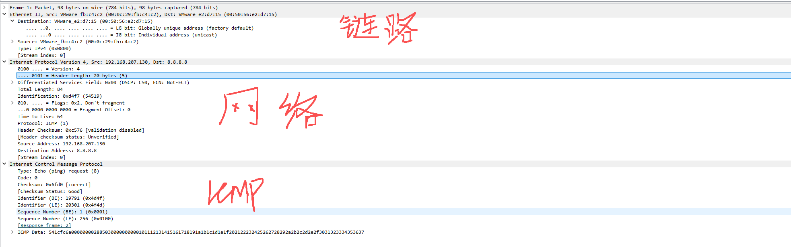
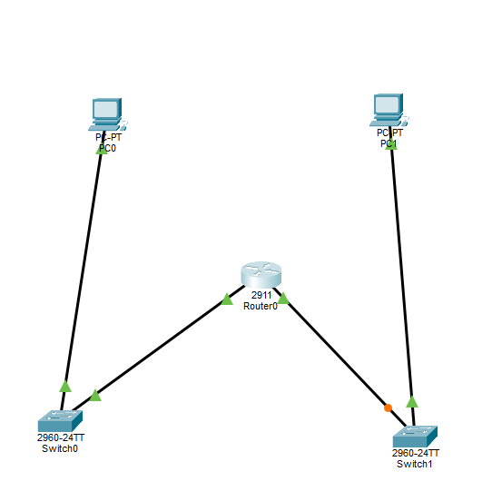

# Chapter 8 — Networking basics, verified on the VM

Goal: understand how a packet is built, and prove each idea on my own VM instead of only reading about it. 8.1 learned on **Day 15** (2026-11-17); 8.2 (IP and subnets) follows on Day 16.

## 8.1 Layers and packet capture

### The TCP/IP model (4 layers)

Every packet is wrapped layer by layer, like a parcel: each layer adds its own **header** around what the layer above gave it (**encapsulation**). The receiver unwraps from the outside in.

```text
[ Ethernet header [ IP header [ TCP/ICMP header [ data ] ] ] ]
```

| Layer | Job | Parcel analogy | Seen on my VM |
|---|---|---|---|
| 4 Application | what the data **is** | the goods in the box | HTTP (`curl localhost`), SSH, the `ls` I type over SSH |
| 3 Transport | which **program** on the machine | recipient's name | TCP, **ports**: 22 = sshd, 80 = nginx |
| 2 Network (Internet) | which **machine**, end to end | delivery address | **IP**: `192.168.207.130`, ICMP, TTL |
| 1 Link | which device **next**, inside this LAN | the courier's hand-off slip | **MAC**, ARP, NIC `ens33` |

Rule of thumb: content → application; port → transport; IP → network; MAC / NIC → link.

### The OSI model (7 layers)

The textbook model splits the same stack more finely. Interviews ask about it.

| OSI | Name | TCP/IP | Examples |
|---|---|---|---|
| **7** | Application | Application | HTTP, SSH, DNS |
| 6 | Presentation | Application | encryption, encoding |
| 5 | Session | Application | keeping a connection open |
| **4** | Transport | Transport | TCP, UDP, ports |
| **3** | Network | Network | IP, ICMP, routers |
| **2** | Data Link | Link | MAC, ARP, Ethernet, switches |
| 1 | Physical | Link | cable, fibre, Wi-Fi signal |

Bottom-up mnemonic: **P**lease **D**o **N**ot **T**hrow **S**ausage **P**izza **A**way.

"Layer 2 problem" = MAC / switch / ARP; "Layer 3 problem" = IP / routing; "L4 load balancer" = by IP + port; "L7 load balancer" = by HTTP content.

### Capture a ping with tcpdump

`tcpdump` prints every packet that passes a network interface. Two SSH windows: A captures, B pings.

```console
# window A
admin123@admin:~$ sudo tcpdump -i ens33 -n icmp
listening on ens33, link-type EN10MB (Ethernet), snapshot length 262144 bytes
09:16:42.979892 IP 192.168.207.130 > 8.8.8.8: ICMP echo request, id 19790, seq 1, length 64
09:16:42.986651 IP 8.8.8.8 > 192.168.207.130: ICMP echo reply, id 19790, seq 1, length 64
...
^C
8 packets captured

# window B
admin123@admin:~$ ping -c 4 8.8.8.8
```

| Part | Meaning |
|---|---|
| `-i ens33` | only this interface |
| `-n` | show IPs as numbers, no name lookups |
| `icmp` | filter: only ping packets (otherwise my own SSH traffic floods the screen) |
| `-c 8` | stop after 8 packets (`ping -c 4` = send 4: 4 requests + 4 replies = 8) |
| `-w file.pcap` | write packets to a file instead of printing |

Reading a line: time · `IP` · source `>` destination · `ICMP echo request` (ping) / `echo reply` (answer) · `seq` number. Request → reply took about 7 ms, the same as `ping` reports. **No port numbers**: ICMP sits directly in IP (layer 3) and never uses TCP.

Save to a file and copy it to Windows:

```console
admin123@admin:~$ sudo tcpdump -i ens33 -n icmp -c 8 -w ~/ping.pcap
8 packets captured
admin123@admin:~$ ls -l ~/ping.pcap
-rw-r--r-- 1 tcpdump tcpdump 936 Nov 17 09:20 /home/admin123/ping.pcap
```

The file is owned by `tcpdump`: after starting with `sudo`, tcpdump drops to its own unprivileged user before writing (least privilege). Others still have `r`, so I can copy it.

```powershell
# Windows PowerShell — NOT inside the VM
PS C:\Users\HP> scp admin123@192.168.207.130:~/ping.pcap $HOME\Desktop\
ping.pcap                                  100%  936   457.1KB/s   00:00
```

`scp source destination`, like `cp`. The side with `user@host:` is the remote machine (path after `:` is on that machine); the side without it is the local machine. Upload = swap the two sides.

### Read the layers in Wireshark

Opened `ping.pcap` in Wireshark (Windows). Top pane = packet list, middle = layers of the selected packet, bottom = raw bytes.



Packet 1 (echo request):

| Wireshark line | Layer | Key fields |
|---|---|---|
| Frame 1 | — (capture info, not a real header) | 98 bytes |
| Ethernet II | 2 Data Link | Src `00:0c:29:fb:c4:c2` (my VM), **Dst `00:50:56:e2:d7:15`** |
| Internet Protocol Version 4 | 3 Network | Src `192.168.207.130`, Dst `8.8.8.8`, **TTL 64**, Protocol ICMP (1) |
| Internet Control Message Protocol | 3 Network (ICMP rides inside IP) | Type 8 = echo request, seq 1 |

No TCP/UDP line: ping does not use the transport layer.

### Finding 1: the destination MAC is not Google's

The packet goes to `8.8.8.8`, but the destination MAC belongs to a VMware device. Checked on the VM:

```console
admin123@admin:~$ ip route
default via 192.168.207.2 dev ens33 proto dhcp src 192.168.207.130 metric 100
192.168.207.0/24 dev ens33 proto kernel scope link src 192.168.207.130 metric 100
admin123@admin:~$ ip neigh
192.168.207.1 dev ens33 lladdr 00:50:56:c0:00:08 REACHABLE
192.168.207.254 dev ens33 lladdr 00:50:56:fe:3c:5b STALE
192.168.207.2 dev ens33 lladdr 00:50:56:e2:d7:15 STALE
```

The default gateway is `192.168.207.2`, and its MAC is exactly the destination MAC in the capture.

- **IP = final destination**, unchanged end to end.
- **MAC = next hop** on the local network, rewritten at every router.

The VM learns a neighbour's MAC with **ARP** (broadcast "who has 192.168.207.2?"); answers are cached in `ip neigh`. All three neighbours start with `00:50:56`, VMware's vendor prefix.

| Address | Device (VMware NAT defaults) |
|---|---|
| .1 | Windows host, VMnet8 adapter (my SSH client → `REACHABLE`) |
| .2 | NAT gateway |
| .128–.253 | DHCP pool; my VM got .130 (was .129 before a reboot) |
| .254 | VMware DHCP server |

### Finding 2: TTL 64 out, 128 back

TTL (Time to Live) = how many routers a packet may still cross; each router subtracts 1, at 0 it is dropped (stops routing loops). Default start: **Linux 64, Windows 128**.

- Request: TTL **64** → just left my Linux VM, no router passed yet (captured on the VM's own NIC).
- Reply: TTL **128**, exactly Windows' start value with nothing subtracted. Most likely the VMware NAT service on the Windows host built this reply itself instead of forwarding Google's original packet (which would arrive as a start value minus a dozen or so hops).

TTL hints at the sender's OS and how many hops away it is.

### Mistakes I made (Day 15)

| Typed | Problem | Fix |
|---|---|---|
| `scp ...` inside the VM | prompt was `admin123@admin:~$`; scp must run on Windows | check the prompt: `PS C:\...>` = Windows |
| `ping.pacp` | typo | `.pcap` = packet capture |
| `$HOME\Desktop\` in bash | trailing `\` = "command continues on the next line" | Windows paths only in PowerShell |
| ICMP = layer 7 | ICMP is part of layer 3 | no port → not layer 4+ |
| the `ls` I type over SSH = link layer | it is the data itself | application layer |

## 8.2 IP addresses and subnets

Learned on **Day 16** (2026-11-17, evening).

### An IPv4 address

`192.168.207.130` = 4 numbers, each **0–255** because each is 8 bits (`11111111` = 255) → 32 bits in total.

An address has two parts, like a street and a house number:

```text
192.168.207 . 130          (with /24)
network part  host part
```

Two addresses can talk directly (via MAC/ARP, no router) only if their **network parts match**. With `/24`: `192.168.207.9` is on my VM's network; `192.168.208.130` is not.

### Prefix (CIDR) and subnet mask

`/24` = the first 24 bits are the network part. The subnet mask writes the same thing with 1s for the network bits:

```text
/24 = 11111111.11111111.11111111.00000000 = 255.255.255.0
```

`/24` (CIDR) and `255.255.255.0` (mask) mean exactly the same.

### How many addresses

```text
host bits     = 32 − prefix
total         = 2^(host bits)          ← the "block size"
usable hosts  = total − 2
```

The first address (host bits all 0) is the **network address**; the last (host bits all 1) is the **broadcast address** (sent to every device on the network, e.g. an ARP "who has …?"). Neither can be given to a device.

| Prefix | Host bits | Block size | Usable | Mask (last byte) |
|---|---|---|---|---|
| /24 | 8 | 256 | 254 | .0 |
| /25 | 7 | 128 | 126 | .128 |
| /26 | 6 | 64 | 62 | .192 |
| /27 | 5 | 32 | 30 | .224 |
| /28 | 4 | 16 | 14 | .240 |
| /29 | 3 | 8 | 6 | .248 |
| /30 | 2 | 4 | 2 | .252 |

Each +1 on the prefix halves the block.

### Block-size method (no binary needed)

Example `192.168.1.100/26`:

1. **Write the prefix and block size first:** /26 → 2⁶ = **64**.
2. Cut the last number into blocks from 0: `0–63 | 64–127 | 128–191 | 192–255`.
3. 100 falls in **64–127**.
4. First of the block = network **.64**; last = broadcast **.127** (= network + block − 1); usable **.65–.126**, **62** hosts.

### My VM

```console
admin123@admin:~$ ip addr show ens33
    inet 192.168.207.130/24 ... brd 192.168.207.255 ...
admin123@admin:~$ ip route
192.168.207.0/24 dev ens33 proto kernel scope link src 192.168.207.130 metric 100
```

| | Value |
|---|---|
| Prefix / block | /24 → 256 (the whole last byte is one block) |
| Network address | 192.168.207.0 (the `ip route` line) |
| Broadcast | 192.168.207.255 (`brd` in `ip addr`) |
| Usable | .1–.254, 254 hosts |
| In use | .1 Windows host · .2 NAT gateway · .128–.253 DHCP pool (my VM: .130) · .254 DHCP server |

This is also why `ssh` to `192.168.207.255` on Day 1 could not work: it is the broadcast address, not a machine.

### 10 practice questions (closed book, 10/10)

| # | Address | Network | Broadcast | Usable range | Hosts |
|---|---|---|---|---|---|
| 1 | 192.168.1.10/24 | .0 | .255 | .1–.254 | 254 |
| 2 | 192.168.1.130/25 | .128 | .255 | .129–.254 | 126 |
| 3 | 172.16.5.70/26 | .64 | .127 | .65–.126 | 62 |
| 4 | 10.1.1.45/27 | .32 | .63 | .33–.62 | 30 |
| 5 | 192.168.10.200/28 | .192 | .207 | .193–.206 | 14 |
| 6 | 192.168.0.13/29 | .8 | .15 | .9–.14 | 6 |
| 7 | 10.0.0.6/30 | .4 | .7 | .5–.6 | 2 |
| 8 | 172.16.0.250/26 | .192 | .255 | .193–.254 | 62 |

9. A department needs **50** hosts → **/26** (62 usable); /27 gives only 30.
10. With /27: `.33` and `.62` are on the same network (both in .32–.63); `.33` and `.64` are not (.64 starts the next block).

### Mistakes I made (Day 16, while learning)

| Wrote | Problem | Fix |
|---|---|---|
| /25 → 224 addresses | 2⁷ is 128 | count: 2, 4, 8, 16, 32, 64, 128, 256 |
| `192.168.1.200/27` → broadcast .255, range .193–.254 | cut the blocks by 64 instead of 32 | blocks of 32: .192–.223 → broadcast .223 |
| `10.0.0.77/28` → range .63–.78 | range starts **after** the network address | .65–.78 |
| my VM `/24` worked out as /26 (.128 / .191) | read the prefix wrong | always write prefix + block size first |
| warm-up: `unique -c` | no such command | `uniq -c` |
| warm-up: `du -sh /var/*` without sorting | biggest directory hard to spot | `sudo du -sh /var/* 2>/dev/null \| sort -h` |

## 8.3 Routing and NAT

Learned on Day 17. One question decides where every packet goes: **is the destination on my network?**

- **Yes** → send it straight to that machine (ARP finds its MAC, see 8.4).
- **No** → hand it to the **default gateway** (a router), which forwards it on.

### The routing table on the VM

```console
admin123@admin:~$ ip route
default via 192.168.207.2 dev ens33 proto dhcp src 192.168.207.130 metric 100
192.168.207.0/24 dev ens33 proto kernel scope link src 192.168.207.130 metric 100
192.168.207.2 dev ens33 proto dhcp scope link src 192.168.207.130 metric 100
```

| Line | Meaning |
|---|---|
| `default via 192.168.207.2` | everything not matched below → gateway `.2` (VMware NAT) |
| `192.168.207.0/24 dev ens33` | my own network: no `via`, sent directly |
| `192.168.207.2 dev ens33` | added by DHCP: the gateway itself is directly reachable |
| `metric 100` | priority when two routes match; **lower wins** |

Ask the system which route it actually picks:

```console
admin123@admin:~$ ip route get 8.8.8.8
8.8.8.8 via 192.168.207.2 dev ens33 src 192.168.207.130 uid 1000      ← via = through the gateway
admin123@admin:~$ ip route get 192.168.207.1
192.168.207.1 dev ens33 src 192.168.207.130 uid 1000                  ← no via = direct
```

### traceroute: every hop on the way

Each router lowers TTL by 1; the router where it hits 0 sends back "time exceeded". traceroute sends TTL 1, 2, 3 … and lists who answered.

```console
admin123@admin:~$ sudo apt install -y traceroute
admin123@admin:~$ sudo traceroute -n -I 8.8.8.8
 1  192.168.207.2  0.922 ms  0.860 ms  0.819 ms
 2  * * *
 ...
 8  * * *
 9  8.8.8.8  8.532 ms  8.451 ms  8.373 ms
```

- `-n` numbers only (no DNS lookups), `-I` use ICMP like ping (needs `sudo`; gets more answers through VMware NAT).
- Hop 1 is the default gateway from `ip route`.
- `* * *` = that router did not answer (many ISPs block it). **Not a failure** as long as the destination answers at the end. Only stars from some hop all the way to 30 means the path breaks there.

### NAT: why the internet never sees 192.168.207.130

Private ranges (not routed on the internet): **`10.0.0.0/8`, `172.16.0.0/12`, `192.168.0.0/16`**.
On the way out, a NAT gateway replaces the private source address with its own and swaps it back on the reply.

```console
admin123@admin:~$ curl -s ifconfig.me ; echo      # -s = silent, no progress bar
161.142.151.164                                    # public, not in any private range
```

My VM goes through **two NATs**:

```
VM 192.168.207.130   (VMnet8, gateway .2)
  → VMware NAT 192.168.207.2        NAT 1: source becomes Windows' 192.168.100.4
  → home router 192.168.100.1       NAT 2: source becomes public 161.142.151.164
  → internet → 8.8.8.8
```

On Windows, `ipconfig` (short version: `ipconfig | findstr IPv4`):

| Adapter | IPv4 | Gateway | Note |
|---|---|---|---|
| WLAN | 192.168.100.4 | 192.168.100.1 | the one actually used for internet |
| VMnet8 | 192.168.207.1 | (none) | Windows' own address on the VM network; **not** the gateway (that is `.2`) |
| VMnet1 | 192.168.50.1 | 192.168.50.254 | host-only network, set by hand for course labs; leave it |
| `169.254.x.x` adapters | — | — | asked DHCP, got no answer, picked an address itself → **169.254 = DHCP failed** |

Why VMnet8 has no gateway: a machine should have **one** default exit. VMnet8 only talks to the VMs on its own /24, which needs no gateway. VM traffic leaves through the VMware NAT service, which uses Windows' normal WLAN route.

VMware network types: **VMnet0 Bridged** (VM gets an address from the real router) · **VMnet1 Host-only** (no internet) · **VMnet8 NAT** (internet through `.2`).

### Two default gateways, decided by metric (real example)

```console
PS C:\Users\HP> route print -4 0.0.0.0
活动路由:
网络目标        网络掩码          网关       接口   跃点数
          0.0.0.0          0.0.0.0    192.168.100.1    192.168.100.4    200
          0.0.0.0          0.0.0.0   192.168.50.254     192.168.50.1    291
永久路由:
          0.0.0.0          0.0.0.0   192.168.50.254     默认
```

Both are `0.0.0.0/0` (default). Metric 200 < 291 → WLAN is used; the VMnet1 route is only a fallback. It is listed under **永久路由**, so it was added by hand with `route -p add`. Risk: if Wi-Fi drops, Windows tries VMnet1 and fails. Kept for now (course labs).

### Lab: two networks and one router in Packet Tracer

File: [`labs/day17-routing.pkt`](labs/day17-routing.pkt) (Cisco Packet Tracer 9.0; local copy in `C:\Users\HP\Cisco Packet Tracer 9.0.0\saves\`).



```
PC0 192.168.1.10 ── Switch0 ── G0/0 192.168.1.1 [Router0] G0/1 192.168.2.1 ── Switch1 ── PC1 192.168.2.10
      network A: 192.168.1.0/24                                    network B: 192.168.2.0/24
```

Router (2911, CLI tab; answer `no` to the setup dialog):

```
enable                                  ! Router#        (short: en)
configure terminal                      ! Router(config)# (short: conf t)
no ip domain-lookup                     ! stop typos from being looked up in DNS
interface g0/0                          ! Router(config-if)#
 ip address 192.168.1.1 255.255.255.0   ! Cisco takes a mask, not /24
 no shutdown                            ! interfaces start "administratively down"
interface g0/1
 ip address 192.168.2.1 255.255.255.0
 no shutdown
end
show ip interface brief                 ! short: sh ip int br
```

```
Interface              IP-Address      OK? Method Status                Protocol
GigabitEthernet0/0     192.168.1.1     YES manual up                    up
GigabitEthernet0/1     192.168.2.1     YES manual up                    up
GigabitEthernet0/2     unassigned      YES unset  administratively down down
```

Both columns `up` = cable connected **and** link working. `administratively down` = never given `no shutdown` (red link lights).

PCs (Desktop → IP Configuration → Static): IP, mask `255.255.255.0`, **gateway = the router interface on their side** (`.1`).

| PC | IPv4 | Gateway |
|---|---|---|
| PC0 | 192.168.1.10 | 192.168.1.1 |
| PC1 | 192.168.2.10 | 192.168.2.1 |

Test from PC0:

```
C:\>ping 192.168.2.10
Request timed out.                                    ← first packet lost while ARP resolves the gateway's MAC
Reply from 192.168.2.10: bytes=32 time<1ms TTL=127    ← 128 − 1 router = 127
...
C:\>tracert 192.168.2.10
  1   0 ms   0 ms   0 ms   192.168.1.1                ← PC0's default gateway
  2   2 ms   0 ms   0 ms   192.168.2.10
```

Reading TTL backwards: start values Linux **64**, Windows **128**, Cisco **255**. `TTL=127` → 1 router on the way; `ping 192.168.1.1` replied `TTL=255` → the router itself, 0 hops.

### Broken on purpose: PC0 without a gateway

| Test | Result | Why |
|---|---|---|
| `ping 192.168.1.1` | 4/4 replies | same network → sent directly, no gateway needed |
| `ping 192.168.2.10` | `Request timed out` | other network → needs the gateway, and there is none |

Rule: **same network works, other networks don't → check the gateway first** (`ip route` on Linux, `ipconfig` on Windows, IP Configuration in Packet Tracer).

### Mistakes I made (Day 17)

| Wrote | Problem | Fix |
|---|---|---|
| warm-up: /24 → 255 addresses, 253 usable | 255 is the highest number, not the count (numbering starts at 0) | 2⁸ = **256**, usable **254** |
| `ip address 192.168.2.1 255.255.255.` + Enter | mask missing its last `0` | retype the whole line |
| `end` typed again at `Router#` | unknown word → IOS tries to telnet to a host called "end" and looks it up in DNS (`Translating "end"...`) | `Ctrl+Shift+6` to abort; `no ip domain-lookup` once in config mode |
